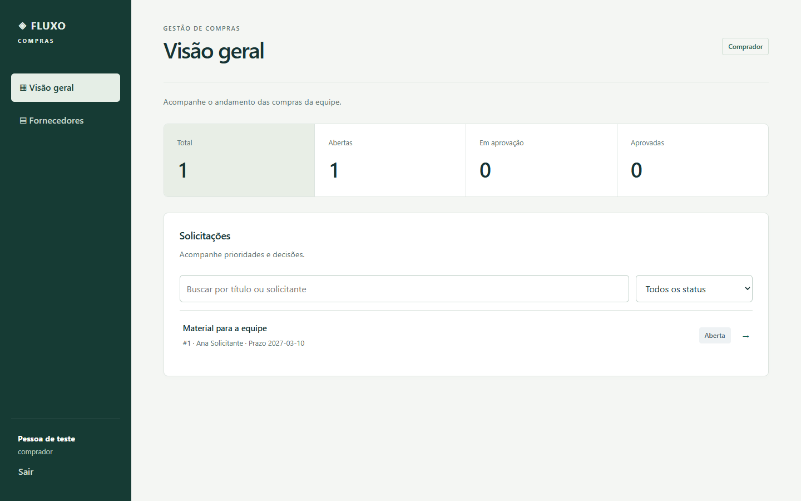
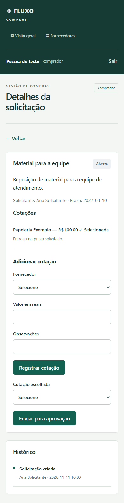

# Verificação da interface

Rodada de novembro de 2026, sobre a branch do PR de segurança existente. A captura anterior usa `main`; ela não corresponde à base exata do diff deste PR.

## Telas e estados

Login, visão geral, nova solicitação, fornecedores, detalhe, cotações, decisão e histórico. A apresentação compartilha estilos de foco, erros, carregamento e ausência de dados, mantendo campos, papéis e sessão HttpOnly existentes.

Os testes visuais abrem painel, fornecedores e detalhes como solicitante, comprador e aprovador em 390 e 1440 px; também abrem nova solicitação para solicitante. As respostas de API são fixtures isoladas no teste. Não foi criado bypass nem modo demo na aplicação de produção. As capturas não comprovam persistência, envio de todos os formulários ou todos os estados transitórios.

## Evidência

- Build, lint e quatro testes de regras passaram.
- Seis testes de interface passaram, verificando telas por papel e ausência de transbordamento horizontal.
- `npm audit`: nenhuma vulnerabilidade.
- MySQL não estava disponível no ambiente local. O [CI da implementação](https://github.com/LeonardoCarrilho/sistema-compras/actions/runs/43127412515) passou com MySQL 8.4, schema e seed, incluindo `test:integration` e `test:e2e` reais. Esse resultado é separado das fixtures visuais.

As imagens abaixo usam exclusivamente fixtures de teste.

## Checker visual

Referência anterior: `GATE: FAIL 10 (round 1 of 3)`. Interface atual: `GATE: FAIL 15 (round 2 of 3)`. A contagem é de regras do checker, não uma pontuação de qualidade. A rodada final com justificativas contextuais permanece pendente.

O checker isolado de layout falhou internamente (`r.sections is not iterable`); não foi repetido nem considerado aprovado. Formulários e áreas de trabalho foram preservados em vez de convertidos em seções de marketing. Logs, perfis e capturas extensas ficam em `.taste-skill/`, fora do Git.
